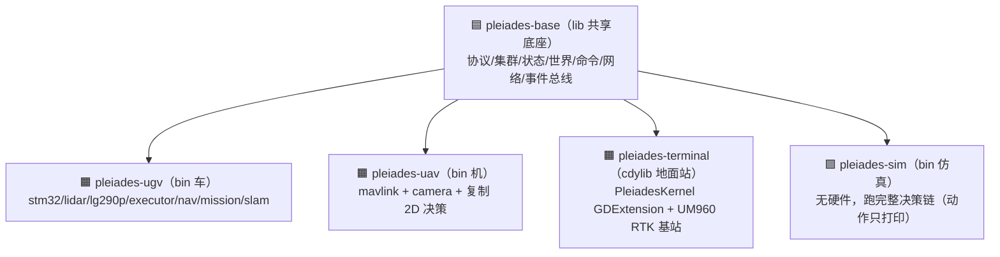
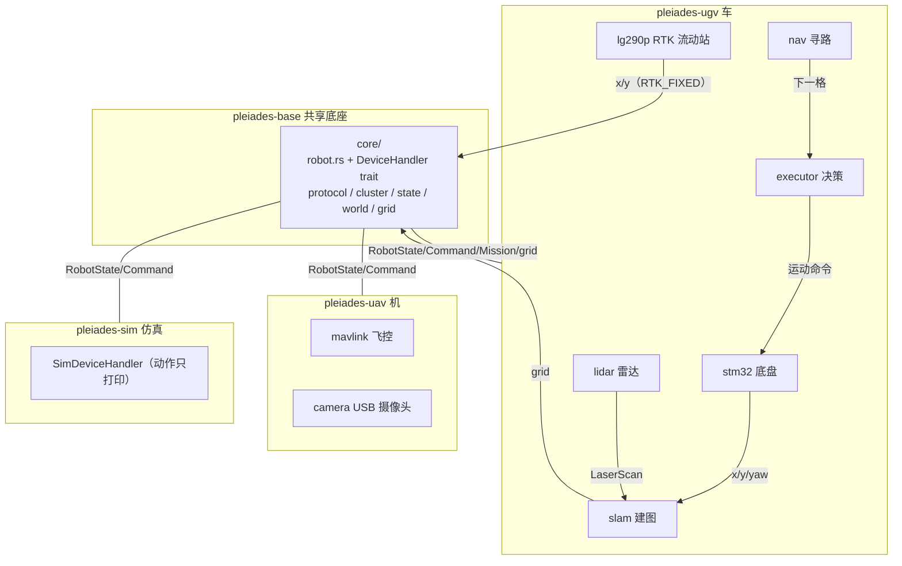
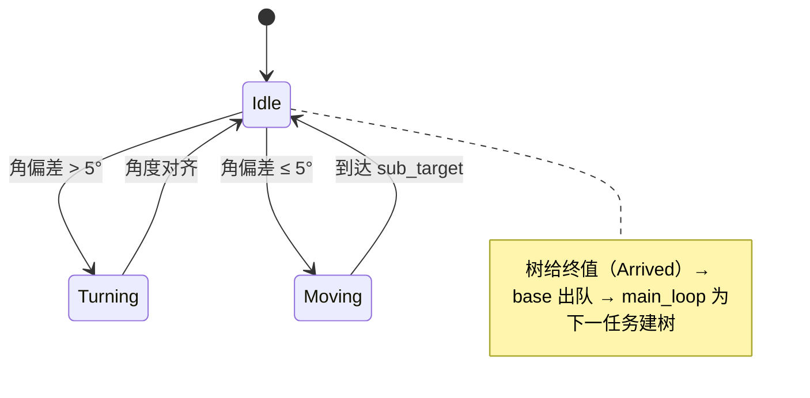
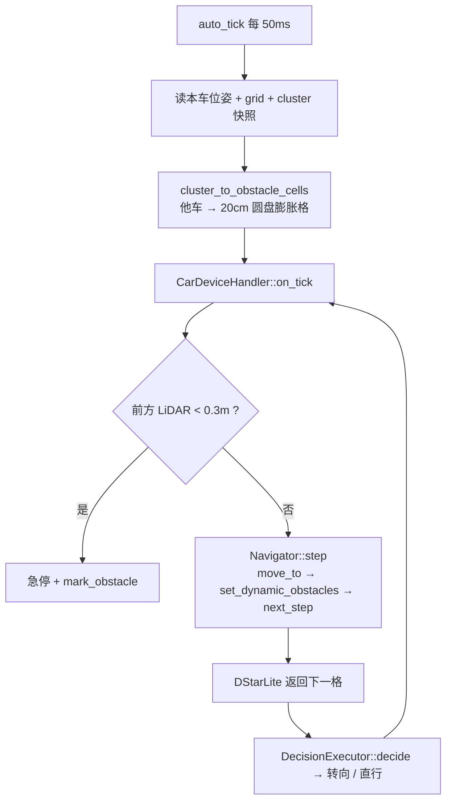
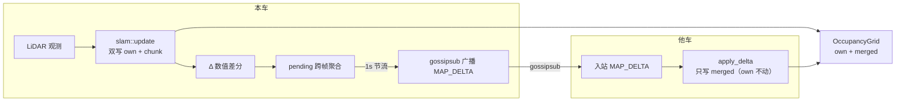
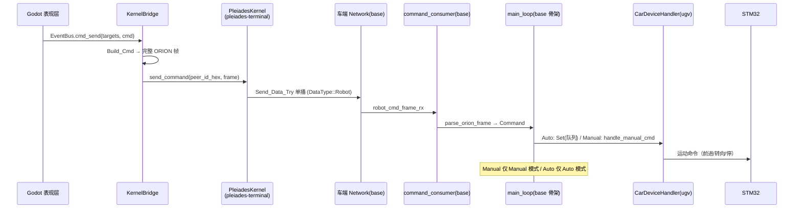

# Robot 架构说明（robot_arch）

> 创建日期：2026-08-17
> 更新日期：2026-10-28（Task 37 Step 5：`Follow` 叶子改为**不经 D\***、朝目标方向给一格（`uav_sim/mission/follow.rs`，`next_cell = world_to_grid(me + 0.5 m·unit(target−me))`，`d>4.0` 前进 / `d≤2.5` 停 / 带内沿用上拍），并**撤销**上一轮误加的直线跟随任务类型（`Mission` 回两变体，`TASK_SET` 仍只解 type 0/2），§8.10。Task 37 Step 4：sim 无人机跟随 —— `Mission::Follow`（type=2）+ `uav_sim/mission/follow.rs`（距离带 + 迟滞 + 丢失停），真机/车栈建平凡树，§8.9。Task 37 Step 3：像素 → 世界 (x,y) 的地面平面投影（`[detector.camera]` 内参/外参 + 纯函数 + 5 条拒答保护），§8.8。Task 37 Step 2：uav/sim 各一份 detector 设备（`[detector]` 段 + 帧源 + 覆盖式结果槽位），§8.7。Task 37 Step 1：三处相机统一为「生产者写槽位 + 消费者同步读最新帧」，新增 `stream` / `stream_fps` 与 `latest_frame()`，§8.6。Task 36 Step 4：base 接线 `TickOutcome` / `build_task` / 自动出队；ugv `goal.rs` + `planning/` → `nav/`，新增 `mission/` Goto 树。Step 3：删协同 —— 三份 `planning/assignment.rs` 移除；`Mission` 收敛为单变体 `Goto { x, y }`；TASK_SET 载荷去群发段）
> 范围：Robot 子系统（workspace 五 crate + 相关 Network 数据面）
> 对应任务：Task 14（群发 Goto）/ Task 15（多车路径规划）/ Task 17（循路改善）/ Task 18（Circle 命令）/ Task 19（mDNS 发现）/ Task 23（crate 拆分：底座共享 + 设备端独有）/ Task 24（RTK 定位）/ Task 25（node_type 广播）/ Task 26（Godot 命令通道）/ Task 27（UAV 寻路忽略地面障碍）/ Task 28（CameraDevice）/ Task 29（YOLO-v8 目标检测）

---

## 0. 总体形态：一个底座 + 三个设备端 + 仿真节点

Task 23 把「一份代码适配所有设备」重构为「**底座共享 + 设备端独有**」——异构设备在「共享世界状态」层同构、在「设备实现」层异构，底座只统一前者，后者各写各的。

```toml
[workspace]
members = ["pleiades-base", "pleiades-ugv", "pleiades-uav", "pleiades-terminal", "pleiades-sim"]
```



- **底座单一来源**：协议/集群/状态/世界的定义在 `pleiades-base` 一处，各设备端同时生效。
- **设备端彻底分离**：车的二进制没有 mavlink，机没有 stm32，地面站没有车机驱动。
- **仿真节点**：`pleiades-sim` 无硬件，`on_tick` 跑完整决策链（寻路 + 三状态机），动作只打印，用于测试决策链。
- **各自编译**：`cargo build -p pleiades-ugv / -p pleiades-uav / -p pleiades-terminal / -p pleiades-sim` 互不拖累。

---

## 1. 整体架构

### 1.1 目录结构（workspace 五 crate）

```text
pleiades-base/                    # 🟦 lib 共享底座（车/机/地面站同一份）
└── src/
    ├── lib.rs                    # 模块声明 + pub use 导出
    ├── main.rs                   # [[bin]] Pleiades（PC 纯推理节点）
    ├── bootstrap.rs              # core_bootstrap()：配置→日志→EventBus→Storage→Network→Core
    ├── Config/ Network/ ML_Engine/ PeerManagement/ Orchestrator/
    │   Storage/ Session_Manager/ EventBus/ TUI/ CLI/ VM/ API/   # 共享基础设施
    ├── ML_Engine/Yolo/           # YOLO-v8 目标检测（safetensors，与 GGUF 管线隔离，Task 29）
    └── Robot/
        ├── mod.rs                # pub mod core; pub mod util; + re-export
        ├── core/                 # 🟦 底座核心（共享，车机同一份）
        │   ├── robot.rs          # Robot::new() + DeviceHandler trait + 主循环骨架
        │   ├── command.rs        # 三层命令（Mode/Manual/Auto）；Mission 已迁至 mission_queue/element.rs
        │   ├── command_consumer.rs  # 命令入站消费（ORION 帧 → Command）
        │   ├── mission_queue/    # 任务队列（Task 36：元素 + 队列）
        │   │   ├── element.rs    # Mission / TaskId / QueuedTask
        │   │   └── queue.rs      # MissionQueue（replace/append/preempt/head/pop_next）
        │   ├── behavior_tree/    # 行为树引擎（Task 36：非泛型 + async + 失败码）
        │   │   ├── status.rs     # Status / FailCode（通用码 0~4 + Device(u16) 1000+）
        │   │   ├── frame.rs      # Frame{dt_ms,tick_no,out} / MotionOut{next_cell}
        │   │   ├── node.rs       # trait Node（async tick + halt；halt 幂等）
        │   │   ├── composite.rs  # Sequence / ReactiveSequence / Fallback / ReactiveFallback
        │   │   ├── decorator.rs  # Timeout / Retry / Guard / Inverter / Repeat / RepeatForever
        │   │   └── leaf.rs       # Wait / Action / Condition
        │   ├── mode.rs           # OpMode（Manual/Auto，默认 Auto）
        │   ├── state.rs          # RobotState / ExecuteState / DecisionState
        │   ├── protocol/         # ORION 统一协议
        │   │   ├── frame.rs      # 帧编解码（magic/len/seq/sysid/compid/msgid/payload/checksum）
        │   │   ├── messages.rs   # POSE/MAP_FULL/MAP_DELTA/MANUAL_CONTROL/TASK_SET 五类消息
        │   │   └── command_decode.rs  # parse_orion_frame → Command
        │   ├── cluster/          # 集群数据面（多车）
        │   │   ├── cluster_info.rs   # ClusterInfo / ClusterInfoTable
        │   │   ├── consumer.rs       # 入站 POSE/MAP_DELTA → 表/地图
        │   │   └── maintenance.rs    # 周期清理失联车（2s）
        │   ├── grid.rs           # OccupancyGrid（own/merged 双表，log-odds 三态）
        │   ├── world.rs          # 世界（grid + cluster，纯地图只读接口 get_cell/get_agents）
        │   └── map_delta.rs      # MapDelta 地图增量协议类型
        └── util/
            └── serial/           # 通用串口 TX+RX 收发（spawn_port，车机共用）

pleiades-ugv/                     # 🟧 bin 车设备端（独有）
└── src/
    ├── main.rs                   # 入口（core_bootstrap + parse_origin + ugv_bootstrap）
    ├── config.rs                 # UgvConfig = flatten BaseConfig + chassis/lidar/lg290p/obstacle_inflation_radius
    ├── bootstrap.rs              # ugv_bootstrap()：Robot::new + CarDeviceHandler
    ├── device/                   # 设备子目录（Task 24 起新增）
    │   └── lg290p/               # RTK 流动站 LG290P 驱动（geo.rs + robot_bus 订阅转发 RTCM）
    └── ugv/
        ├── mod.rs
        ├── types.rs              # CarType 枚举（X3 / X3Plus / X1 / R2 + motion_limits）
        ├── stm32/                # STM32 底盘驱动（mod.rs + protocol.rs + constants.rs）
        ├── lidar/                # YDLIDAR Tmini 驱动（mod.rs + parser.rs + checksum.rs + types.rs + constants.rs）
        ├── executor.rs           # DecisionExecutor 决策执行器（三状态机，纯决策零副作用）
        ├── nav/                  # 导航层（navigator + pathfinder + cluster_obstacles）
        ├── mission/              # 任务层（mod：Mission → 树分派；goto：Goto 树）
        ├── emergency_stop.rs     # 急停（前方扇形障碍强制 stop）
        ├── slam/                 # lidar_mapper + task + odometry（车 2D 建图）
        └── robot_handler.rs      # CarDeviceHandler（实现 DeviceHandler）

pleiades-uav/                     # 🟧 bin 机设备端（独有）
└── src/
    ├── main.rs                   # 入口（core_bootstrap + parse_origin + uav_bootstrap）
    ├── config.rs                 # UavConfig = flatten BaseConfig + flight_ctrl + camera
    ├── bootstrap.rs              # uav_bootstrap()：Robot::new + UavDeviceHandler + CameraDevice 注入 device_caps
    ├── device/                   # 设备子目录（Task 28）
    │   └── camera/               # USB 摄像头 CameraDevice（nokhwa + DeviceCapability）
    └── uav/
        ├── mod.rs
        ├── mavlink/              # MAVLink 飞控驱动（mod.rs + protocol.rs + types.rs + constants.rs）
        ├── robot_handler.rs      # UavDeviceHandler（实现 DeviceHandler，on_tick 已接 2D 决策）
        ├── executor.rs           # 车 2D 三状态机（已接线；后 3D 化）
        ├── goal.rs               # 车 2D 目标服务（已接线）
        └── planning/             # 车 2D 寻路（已接线；后 3D）

pleiades-terminal/                # 🟧 cdylib 地面站（独有，原 SrcPictorKernel）
└── src/
    ├── lib.rs                    # PleiadesKernel（GodotClass，哑管道桥）+ send_user_command（Task 26）
    ├── config.rs                 # TerminalConfig = flatten BaseConfig + [um960]（Task 24）
    └── device/
        └── um960/                # RTK 基站 UM960 驱动（geo.rs + rtcm_parser.rs + 状态机）

pleiades-sim/                     # 🟪 bin 仿真节点（无硬件，独有）
└── src/
    ├── main.rs                   # 入口（core_bootstrap + parse_origin + sim_bootstrap）
    ├── config.rs                 # SimConfig = flatten BaseConfig + obstacle_inflation_radius
    ├── bootstrap.rs              # sim_bootstrap()：Robot::new + SimDeviceHandler
    └── sim/
        ├── sim_handler.rs        # SimDeviceHandler（DeviceHandler；持 TaskStack 并转发 build/tick/reset）
        ├── executor.rs           # 车 2D 三状态机（两栈共用一份）
        ├── ugv_sim/              # ★ 车栈：复刻 pleiades-ugv 的 nav/ + mission/（树文件逐字相同）
        │   ├── mod.rs            # Stack：nav + 树实例表 + build/tick/finish/reset
        │   ├── nav/              # navigator（sim 到达判据）/ pathfinder / cluster_obstacles
        │   └── mission/          # mod.rs（Mission → 树穷尽分派）+ goto.rs（Goto 树）
        ├── uav_sim/              # ★ 机栈：复刻 pleiades-uav 的 nav/ + mission/
        │   ├── mod.rs            # 同形（ObstacleMode::Ignore、不订建图增量）
        │   ├── nav/
        │   └── mission/          # mod.rs + goto.rs + follow.rs（★ 唯一真跟：task_37 Step 4/5，叶子不经 D*）
        └── planning/             # 只剩 cluster_obstacles（他车 → 动态障碍格；建图 task 在用）
```

**sim 双栈差异登记表（Task 36 Step 6，§12.6.4）**

| 编号 | 差异 | 位置 | 理由 / 归属 |
|---|---|---|---|
| D-S1 | `pathfinder.rs`：`MAX_COMPUTE_ITERS = 60_000`（真机 10_000）+ 等代价迟滞 `Choose_Step`/`TIE_EPS` + `Value() = min(g,rhs)` | `sim/*_sim/nav/pathfinder.rs` | task_31 Step 7 实测修复：10k 在空地图远目标下提前 break → `rhs[start]=INF` → **首条远目标指令被静默丢弃**。**建议后续单独 task 反哺 ugv/uav**（本 step 不改真机） |
| D-S2 | 到达判据：预测停点 + 逐轴 0.06 + 格内逼近 0.26（真机世界距离 0.3 m + 入格即到达） | `sim/*_sim/nav/navigator.rs` | §十一 #37 明确接受（仿真底盘 3 m/s² 惯性，1.2 m/s 时滑行 0.3 m） |
| D-S3 | `cluster_obstacles.rs` 在 sim 有 3 份（`planning/` + 两栈） | `sim/planning/`、`sim/*_sim/nav/` | `sensors/` 不动（`mapping_task.rs` 依赖 `planning::`），而 `nav/` 要复刻真机结构 → 只能多一份 |
| D-S4 | 建图增量：车栈 `subscribe_map(Some)`，真机 `None` | `sim/ugv_sim/mod.rs` | Step 4 已登记（D6）；sim 的 mapper 会广播 `map_tx`，不订就会「画出来的墙对规划不可见」 |
| D-S5 | `Chassis` 判型走世界零件名（`Kind_Of_World("diff_drive_ugv"｜"quadrotor_uav")`），不加 `Chassis::Kind()` | `pleiades-sim/src/sim/sim_handler.rs` | §12.6.5 的两个选项中选了第 2 个（「按 `world_name` 判断，省一次 trait 改动」），因为 §12.6.2 要求「不动 `chassis/`」 |
| D-S6 | **跟随只在机栈**：`Follow` → `ReactiveFallback` 持续树（`follow.rs`）；车栈/真机 → 平凡 `Success` 树。人作为动态障碍**无法真注入 D-star**（机栈 Ignore 读空图，`mark_obstacle` 当拍即失效），只否决落在人格的 `next_cell`；外层用 `ReactiveFallback`（记忆式 `Fallback` + `Running` 型 Hold = 死锁在兜底分支） | `sim/uav_sim/mission/follow.rs`、`sim/uav_sim/mission/mod.rs`、`sim/ugv_sim/mission/mod.rs`、`uav/mission/mod.rs`、`ugv/mission/mod.rs` | task_37 Step 4。机栈 `Navigator` 是 `ObstacleMode::Ignore`（喂空栅格 + `dynamic_obstacles` 恒空），`mark_obstacle()` 的标记会被同拍重算抹掉 → 真注入需给 `Navigator` 加 `set_extra_obstacles()` 并让机栈用 `Respect`（`nav/` 不在允许清单，另开 task）；车栈没有相机/detector，Hold 会永远占队首 → 用平凡 `Success` |

| D-S7 | **`Follow` 叶子不经 D\***：`Follow` → `ReactiveFallback[ ReactiveSequence[ TargetGate(有目标且未过期), Condition(未太近), StepLeaf ], HoldLeaf ]`；`StepLeaf` **不调 `nav.set_goal` / `nav.step`**，`next_cell = world_to_grid(me + 0.5·unit(target−me))`；`d > 4.0` 前进、`d ≤ 2.5` 停、带内沿用上拍（迟滞）；`nav` 只用于 Hold 时 `clear_goal()` | `sim/uav_sim/mission/follow.rs`（`-p` 无需改调用方：`build` 签名不变） | task_37 Step 5。Step 4 的 `nav.set_goal → D*` 跟随被 4 连通「下一格」带偏（executor 追格心 + `Turning` 不反向修正），人类指定**不改行动逻辑**（`executor.rs` / `nav/` 只读）→ 把修正收进叶子；代价是不转向、不绕障、不修正横向偏差（§六.6 另开任务）。上一轮误加的直线跟随任务类型已在本步全部撤销 |

**分层语义**：`base`（协议/状态/世界/命令/集群，共享）→ 设备端 `ugv`/`uav`/`sim`（驱动 + 决策 + 寻路 + 建图，各写各的）→ `terminal`（地面站，纯透传）。



### 1.2 核心数据结构

| 结构 | 位置 | 职责 |
|---|---|---|
| `RobotState` | `base/robot/core/state.rs` | 位姿 schema：`vx/vy/vz`、`battery`、`attitude{yaw}`、`gyro/accel/mag`、世界坐标 `x/y/z`（米）。**设备端 RX 回调单一写入** |
| `ExecuteState` | `base/robot/core/state.rs` | main_loop 唯一写：`state`（DecisionState）+ `sub_target: Option<(i32,i32)>`（本车意图，供遥测） |
| `DecisionState`/`MotionAction`/`DecisionResult` | `base/robot/core/state.rs` | 决策层三件套（Idle/Turning/Moving + 动作意图），设备端决策器消费 |
| `Robot` | `base/robot/core/robot.rs` | 中枢：共享状态/广播通道/模式/队列/集群表句柄；`new()` 建共享态，`run(device)` 跑主循环骨架 |
| `DeviceHandler` trait | `base/robot/core/robot.rs` | **设备处理器接口**：`start`/`handle_manual_cmd`/`reset`/`build_task`（建树，幂等）/`on_tick`（返回 `TickOutcome`）/`stop`/`shutdown`（设备端各自实现，底座不依赖具体设备类型） |
| `TickOutcome` | `base/robot/core/robot.rs` | 设备 tick 的结果：`Running` / `Terminated(Option<FailCode>)`；`Terminated` 才由 `main_loop` 出队 |
| `Mission` | `base/robot/core/mission_queue/element.rs` | 两变体：`Goto { x, y }` + `Follow { x, y }`（Task 37 §五，`x/y` 预留）；`Follow` **只在 sim 机栈真跟**（`type=2`），真机/车栈建平凡树。`TASK_SET` 只解 `type=0/2`，其余值收到即 `warn` 丢弃。Task 36 已删 `Circle` 与 `members`；同文件还有 `TaskId(u64)` / `QueuedTask { id, mission }` |
| `OpMode` | `base/robot/core/mode.rs` | `Manual` / `Auto`，**默认 Auto** |
| `ClusterInfoTable` | `base/robot/core/cluster/cluster_info.rs` | `HashMap<peer_id, ClusterInfo>`，他车位姿（x/y/yaw/vx/vy/sub_target） |
| `OccupancyGrid` | `base/robot/core/grid.rs` | 地图表示（own/merged 双表 + log-odds），CRDT 合并前提 |
| `CarType` | `ugv/types.rs` | 车型枚举（车独有） |
| `Telemetry` | `uav/mavlink/types.rs` | 飞控遥测快照（机独有） |

> **独有状态跟设备走**（Task 23 阶段 B）：`encoders[4]` → STM32 device 内部、`LidarState` → Lidar device 内部（`get_scan()`），均不在共享 `RobotState`。

### 1.3 Executor 状态机（`ugv/executor.rs`，车决策）



- `DecisionExecutor::decide(next_cell, x, y, yaw, current) -> DecisionResult`：**纯决策、零副作用**（不发命令不写状态，结果由 main_loop 单点执行）。
- `auto_tick` 每 **50ms**（`AUTO_TICK_MS`）先比对「队首 `TaskId`」与当前任务：不同 → `build_task`（建树，幂等）；再 `on_tick`；返回 `Terminated` → `pop_next`（唯一出队口）。仅 Auto 模式激活。
- 决策阈值：`sub_target_threshold_m=0.2`、`arrival_threshold_m=0.3`、`turn_speed=10`、`move_speed=30`、`turn_align_threshold_deg=5.0`、`straight_align_threshold_deg=10.0`。

**`on_tick` 流程**（车端 `CarDeviceHandler`，每次 tick）：

1. **① 门闩**：无底盘 → 写 `ExecuteState{Idle, None}`，什么都不做，返回 `Running`。
2. **② 急停**：LiDAR 前方扇形（±45°）最近点 `range < 0.3m` → 立即 `stop()` + `Navigator::mark_obstacle` + 写 `Idle`；**保留 goal**，且**这一拍树不 tick**（时间冻结，`ugv/emergency_stop.rs`）。
3. **③ 树**：当前任务的树 `tick(&mut frame)`（`dt_ms = AUTO_TICK_MS`），叶子把「下一格」写进 `Frame.out.next_cell`；无树则跳过。
4. **④ 决策**：`DecisionExecutor::decide(frame.out.next_cell, …)` → 写 `ExecuteState`（**唯一写点**）→ 若有 `action` 则 `stm32.apply_action(action)`。
5. **⑤ 终值**：树返回 `Success`/`Failure(code)` → `halt` 树 + 从实例表删除 + 清 goal → 返回 `TickOutcome::Terminated(code)`，出队由 base `main_loop` 独占。

### 1.4 启动流程 + 主循环（Robot::new + DeviceHandler）

**装配下沉**（Task 23 C0）：共享装配在 base 的 `core_bootstrap()`；设备装配在各终端 crate 的 `ugv_bootstrap`/`uav_bootstrap`。

```text
各终端 main.rs：
  core_bootstrap()                          ← base：配置→日志→EventBus/Storage→Network→Core
  Ensure_Ugv_Config() / Ensure_Uav_Config() ← 设备端：读自己的设备段
  ugv_bootstrap(config, node_handle, robot_bus, robot_cmd_frame_rx, origin)
     └─ Robot::new(origin, node_handle, robot_bus, robot_cmd_frame_rx, peer_name)
          └─ 建共享状态 + spawn 非设备 task（state_notifier / cluster_consumer / cluster_cleaner / command_consumer）
        CarDeviceHandler::new(robot, config, node_handle, origin)   ← 设备处理器
        robot.run(device, cmd_rx)          ← spawn 主循环骨架（后台）
  boot.run()                               ← base：阻塞（network 事件循环 + TUI + Core）
```

`Robot::new` 依次：建 `robot_state`（注入 `origin`）+ 广播通道 `pose_tx`/`map_tx` + `grid` + `op_mode` + `mission_queue` + `execute_state` + `cluster_table`；spawn `state_notifier`（100ms 位姿广播）、`cluster_consumer`（入站 POSE/MAP_DELTA）、`cluster_table_cleaner`（2s 清失联）、`command_consumer`（ORION 帧 → Command）。

`Robot::run(device)` 跑主循环骨架（**纯路由，设备操作全走 `DeviceHandler`**）：

| 分支 | 逻辑 |
|---|---|
| 启动 | `device.start()`（设备自管理启动：车 spawn stm32+lidar+Navigator，机 spawn mavlink） |
| `cmd_rx.recv()` | `Mode`→停车+切模式+清队列+`device.reset()`；`Manual`→仅 Manual 模式 `device.handle_manual_cmd()`；`Auto`→仅 Auto 模式 `Set` 替换队列 + `device.reset()` |
| `auto_tick`（50ms，仅 Auto） | 队首 `TaskId` 变化 → `device.build_task()`；读 `RobotState` 快照 → `device.on_tick(&rs, &execute_state)`（急停+树+决策+终值，设备端实现）；返回 `Terminated` → `pop_next` |
| `cancel.cancelled()` | `device.stop()` → `device.shutdown()`（停车 + 关设备） |

---

## 2. 寻路机制（`ugv/nav/`，车）

### 2.1 D* Lite + 动态障碍

- 规划器：`ugv/nav/pathfinder.rs` 的 `DStarLite`（`g/rhs/u/km/start/goal/dynamic_obstacles`）。
- **`cost()` 判定顺序**（`pathfinder.rs`）：先查 `dynamic_obstacles`（命中 → ∞）→ 越界（∞）→ 静态 `Occupied`（∞）→ 其余 1.0。**4 连通**（无对角移动），Manhattan 启发。
- **动态障碍注入**（`ugv/nav/cluster_obstacles.rs`，Task 17）：`cluster_to_obstacle_cells(others, radius)` 把每辆他车（`ClusterInfo.x/y`）按「圆心 + 半径圆盘」映射为障碍格集合。
- **寻路下沉**（Task 23 决策 D1）：`DStarLite` 由 `Navigator`（`ugv/nav/navigator.rs`）直接持有；`world` 只保留纯地图只读接口 `get_cell`/`get_agents`，不再内嵌寻路。**出队在 base `main_loop`**，导航层不接触任务队列。

**圆形几何膨胀算法**（Task 17，半径 20cm，config `obstacle_inflation_radius = 0.2`，ugv 顶层键）：

```
reach = ceil(R / CELL_RESOLUTION) = ceil(0.2 / 0.5) = 1  → 候选 3×3 邻域
对每个候选格：圆心 (x,y) 到格矩形 [x0,x1)×[y0,y1) 的最近距离 ≤ R 则标记
  px = clamp(x, x0, x1);  py = clamp(y, y0, y1)
  dist² = (x-px)² + (y-py)² ≤ R²  → 标记该格
```

- 格中心 → 1 格；格边 → 2 格；格角 → 最多 4 格（远小于 3×3 方块，不堵通道）。


- 每次寻路前（`Navigator::step`）注入最新障碍：`move_to(当前格)` → `set_dynamic_obstacles(动态障碍)` → `next_step()`。
- 静态地图**不兜底**他车：`lidar_mapper` 对他车格做 `-DYNAMIC_OBSTACLE_DECAY` 主动抵消，使他车格稳定在 Unknown（可通行），避让他车**完全依赖**动态障碍膨胀。

### 2.2 Goto 命令（棋盘散布，Task 14）
> **Task 36 起本节逻辑已从车端删除**：`planning/assignment.rs`（三份）已删，`Mission` 不再带群发名单；群发改由指挥层逐车算点、逐车发帧。以下为历史记录。

`Mission::Goto { x, y, members }`：

- **单车**（`members` 空）：直接以 `(x,y)` 为 goal。
- **群发**（`members` 非空）：`assignment::group_goto_mission`：
  1. `members` 按 peer_id **字节升序**排序（不信任帧序）→ 序号 `i`。
  2. `build_slots(target, grid)` 生成位置列表 `L`：
     - `L[0]` = 精确目标点（头车，peer_id 最小）。
     - `L[1..]` = 棋盘同色格 `(gx+gy)%2==0` 的格中心，切比雪夫环由内向外（r=1..=10），环内固定顺序「正上方起顺时针」。
     - Occupied / 越界格跳过（**全局压缩 = 顺延**：被占格从列表删掉，后续所有车整体后移一位）。
  3. 本车目标 = `L[i]`。
- 所有车跑同一套确定性代码 → 同一份 `L` → **零通信、零协商、零冲突**。
- 错误：`Unreachable`（目标格障碍）/ `OutOfBounds` / `NotMember` / `InsufficientSlots`。

### 2.3 Circle 命令（环形均匀铺开，Task 18）
> **Task 36 起本命令已删除**：`Mission::Circle` 与 `assignment::group_circle_mission` 均已移除。以下为历史记录。

`Mission::Circle { x, y, members }`（`x/y` = 圆心）：

- **半径写死 0.5m = 圆心格与车格之间隔 1 格**，即车落在切比雪夫距离 2 的环 `ring_cells(2)` 上（16 格，正北起顺时针）。
- `build_circle_slots(center, grid)`：枚举 `ring_cells(2)`，过滤越界 / Occupied → 可用格列表（**圆心格 Occupied 不判失败**——围住语义，圆心本身可以是障碍）。
- `group_circle_mission`：`members` 空 → 环第一个位置（正北）；非空 → 排序取序号 `i`，**均匀铺开** `idx = i × available.len() / N`：

| N | 落点 |
|---|---|
| 1（单车） | 正北 (128,126) |
| 2 | 正北 (128,126)、正南 (128,130) —— 直径两端 |
| 3 | 近似 120° 均分 |
| 4 | 北东南西四向 |

```
Goto 棋盘散布（● = 目标点/头车，X = 同色格 (gx+gy)%2==0，其余车由内向外填充 X）：
   . X . X .
   X . X . X
   . X ● X .
   X . X . X
   . X . X .

Circle 环形散布（● = 圆心，X = ring_cells(2) 的 16 格，与圆心隔 1 格；4 车落北东南西）：
   X X X X X
   X . . . X
   X . ● . X
   X . . . X
   X X X X X
```
- 第一版：**到达即停，不朝圆心**（复用 executor 现有「到 goal 后 stop」行为）。
- 被占格先压缩掉（顺延）再均匀铺开，与 Goto 同构。

---

## 3. gossipsub 广播与地图合并

### 3.1 广播内容（gossipsub topics）

| Topic 常量 | 内容 | 发布方 |
|---|---|---|
| `TOPIC_PEER_INFO` | 节点身份 `{"name": ...}` | Network（连接建立后） |
| `TOPIC_MODELS` | 模型能力 `Vec<SupportedModel>` | Network |
| `TOPIC_SESSIONS` | 会话状态 `Vec<SessionSummary>` | Network |
| `TOPIC_ROBOT_POSE` | ORION `MSGID_POSE` 二进制帧（他车位姿） | `state_notifier`（100ms） |
| `TOPIC_ROBOT_MAP` | ORION `MSGID_MAP_DELTA` 二进制帧（地图增量） | `slam_task`（200ms，节流 1s） |

**Robot 侧两条广播链**：

- `state_notifier`（100ms，base `core/robot.rs`）：读 `RobotState` → 组 `PoseData{x,y,yaw,vx,vy,sub_target}` → 本地 `pose_tx` + gossip `TOPIC_ROBOT_POSE`。
- `slam_task`（200ms，每 5 帧 = 1s 节流，ugv `slam/task.rs`）：读 pose + LiDAR scan → `slam::update` 返回 deltas → 跨帧聚合 → `map_tx` + gossip `TOPIC_ROBOT_MAP`。

### 3.2 地图如何整合合并（CRDT 差分思想）

`OccupancyGrid`（base `core/grid.rs`）为**双表结构**：

| 表 | 含义 | 写方 |
|---|---|---|
| `chunk`（merged） | 合并视图：本车观测 + 远端增量 | 本车 `slam::update` + 远端 `apply_delta` |
| `own` | **仅本车观测贡献**（对账上传数据源） | 仅本车 `slam::update` |

- **概率 log-odds 三态**：命中 `+3`、漏打 `-1`，夹断 `±8`；`>+6 → Occupied`、`<-6 → Free`、中间 `Unknown`。
- **本车观测**：`grid.update(gx, gy, occupied)` **双写** own 与 chunk。
- **远端增量合并**：`cluster_consumer` 收到他车 `MSGID_MAP_DELTA` → `grid.apply_delta(gx, gy, delta)` **只写 merged（chunk），不碰 own**（防止他车贡献混入本车 own 导致对账双倍计数）。
- **差分广播**：每帧 `Δ = 新 log − 旧 log`（真实数值差分），跨帧聚合净变化后广播；接收方 `apply_delta` 直接 `merged += Δ` 并 clamp ±8，完成精确重放。
- **动态障碍掩蔽**：广播前对他车格做 `-DYNAMIC_OBSTACLE_DECAY`（=-3）抵消 LiDAR 命中，使他车格在静态地图中稳定在 Unknown（避免把「移动的他车」误标成静态障碍）。



---

## 4. 控制链条

### 4.1 地面站（Pictor）侧架构

地面站是**独立的 Godot 工程**（`GodotProject/Pictor/`），通过 Orion 仓库内的 GDExtension 桥 crate（`pleiades-terminal/`，GodotClass `PleiadesKernel`，原 `SrcPictorKernel/`）接入 libp2p 网络（Task 16 建桥 / Task 23 C4 拆 crate）。原则：**逻辑与表现分离，桥 = 哑管道**（Rust 侧不解析、不合并业务数据，只透传原始 ORION 帧 + peer 事件）。

```
Godot 进程（单进程）
├── KernelBridge（Godot，薄适配器）
│     ├── 上行：robot_frame → parse_orion_frame → EventBus；peer_* → EventBus
│     └── 下行：EventBus.cmd_send → Build_Cmd → kernel.send_command
├── PleiadesKernel（Rust GDExtension = pleiades-terminal，哑管道）
│     └── libp2p swarm（mDNS 自动发现 / gossipsub 广播 / Send_Data_Try 单播）
└── 表现层（Renderer2D / VehiclePanelManager / Camera / ControlMaster）
```

- 桥内 Pleiades 以**无 TUI** 模式跑后台 tokio 线程（`core_bootstrap()` + `run_headless()`，ML/API/VM 照常，仅不启动 TUI）。
- Godot 侧复用 WS 时代的 `parse_orion_frame` / `MapData2D` / `Renderer2D` / 控制链路，只把「数据源」从 WS socket 换成 `robot_frame` 信号。

### 4.2 网络栈与节点发现（mDNS）

`Network_Service` 的 libp2p Swarm 行为组合（`network_service.rs`，base）：**TCP + Noise + Yamux + mDNS + Kademlia + Request-Response + Gossipsub + Identify + Ping**。**地面站（terminal 桥内）与车/机端共用同一套发现机制**。

- **mDNS 局域网发现**（`mdns::tokio::Behaviour`）：UDP 组播（`224.0.0.251:5353`）。
  - Task 19 起缩短间隔：`query_interval = 20s`、`ttl = 60s`（默认 5min/6min，丢包后自愈极慢）。
  - `mdns::Event::Discovered` → `kademlia.add_address` + 主动 `dial` → `ConnectionEstablished` → `PeerManager.Upsert_Peer` 注册。
  - 抗 Wi-Fi 漫游：mDNS 发现后自动 `dial` 重连（WebSocket 时代 TCP 会被 AP 切换杀光，libp2p 不断线）。
- Kademlia 仅在 `WAN` 时 `bootstrap()`（局域网默认关闭，仅作 mDNS 喂地址的路由表）；`bootstrap_peers` 默认空（**当前无静态兜底**，见 `robot_review_problem.md` N14）。

### 4.3 控制下发链条（地面站 → 车，完整链路）

```
地面站 Godot：EventBus.cmd_send(targets, cmd)
  │ KernelBridge._on_cmd_send：
  │   逐车构造 TASK_SET（每帧 missions[0] = 该车目标点；Task 36 起协议无成员名单段）
  │   frame = OrionMessages.Build_Cmd(cmd)     ← Godot 拼好完整 ORION 帧
  ▼
Rust PleiadesKernel（terminal）：send_command(peer_id_hex, frame) → Send_Data_Try 单播（DataType::Robot）
  │ libp2p request-response（unicast，不混入 gossip 遥测）
  ▼
车端 Network（base）：Handle_Request_Response_Event → DataType::Robot → robot_cmd_frame_tx 通道
  ▼
command_consumer（base）：decode_frame → parse_orion_frame → Command ──► cmd_tx
  ▼
main_loop（base 骨架）收 Command，按 op_mode 分发到 device：
  ├─ Mode { SwitchToManual / SwitchToAuto }   → 停车 + 切模式 + device.reset()
  ├─ Manual { Forward/Backward/Spin/Stop/Beep/Takeoff/Land/... }  → 仅 Manual 模式 device.handle_manual_cmd()
  └─ Auto { Set(Vec<Mission>) }               → 仅 Auto 模式：停车 + 替换队列 + device.reset()
```

- 命令走 **request-response unicast**，车端收到后回 `OK` ACK 闭环。
- `parse_orion_frame` 对 `MSGID_TASK_SET` 单分支（Task 36）：`mission_count == 0` → 取消；`> 0` → 逐条 `Mission::Goto` 入队；未知 `type` 该条丢弃，全丢则整帧不生效（队列不动）。
- `ManualCmd` 超集共享 + **设备选择性响应**（车响应 Beep/StartLidarScan 不响应 Takeoff；机响应 Takeoff/Land 不响应 Beep），能力差异靠「响应」而非「声明」表达。



### 4.4 遥测上行链条（车 → 地面站/他车）

```
车端 state_notifier（100ms，base）─► MSGID_POSE ──gossip──► TOPIC_ROBOT_POSE
车端 slam_task（200ms/1s节流，ugv）─► MSGID_MAP_DELTA ──gossip──► TOPIC_ROBOT_MAP
                                    │
                 ┌──────────────────┴──────────────────┐
                 ▼                                     ▼
        Rust PleiadesKernel（terminal）            他车 cluster_consumer（base）
        robot_bus → robot_frame 信号              POSE → ClusterInfoTable
                 ▼                                MAP_DELTA → grid.apply_delta
        Godot _on_robot_frame：parse_orion_frame → EventBus：
          MSGID_POSE      → pose_received(vid, data)
          MSGID_MAP_FULL  → map_full_received(vid, chunk_x, chunk_y, cells)
          MSGID_MAP_DELTA → map_delta_received(voxels)
```

- **地面站地图渲染**：`MAP_FULL` = 替换（`set_full`）、`MAP_DELTA` = 累加（`set_delta`），多车朴素共表（多车合并一致性暂缓）。
- **他车侧** `cluster_consumer`（base）消费：
  - 入站 POSE → 写 `ClusterInfoTable`（供本车动态障碍注入）。
  - 入站 MAP_DELTA → `grid.apply_delta`（合并到 merged，own 不动）。

### 4.5 车辆生命周期（peer 事件驱动）

地面站对车辆「显示/移除」完全由 peer 事件驱动（不依赖心跳超时）：

| peer 事件 | 来源 | 地面站动作 |
|---|---|---|
| `peer_connected` | 连接建立 | `vehicle_registered` → 面板 + Sprite 显示 |
| `peer_disconnected` | 连接断开 | `vehicle_unregistered` → 移除面板 + Sprite |
| `peer_info_updated` | gossipsub peer-info | 面板「连接中」→ 车名 |
| `peer_discovered` / `peer_left` | mDNS 发现/过期 | **不消费**（mDNS 过期 ≠ 断连） |

---

## 5. 设备处理器（DeviceHandler）与节点类型

### 5.1 DeviceHandler trait（Task 23 阶段 C 核心）

base 定义接口、设备端各自实现，消除「底座反向依赖设备端具体类型」：

```rust
#[async_trait]
pub trait DeviceHandler: Send + Sync {
    async fn start(&self) -> Result<(), String>;   // 设备自管理启动
    async fn handle_manual_cmd(&self, cmd: &ManualCmd);
    async fn reset(&self, execute_state: &Arc<RwLock<ExecuteState>>);
    // 任务开始：为该任务建树（幂等：同 TaskId 已有实例 → 只激活、不重建）
    async fn build_task(&self, task: &QueuedTask) -> Result<(), String>;
    // 返回 Terminated 时 main_loop 才出队（唯一出队口）
    async fn on_tick(&self, rs: &RobotState, execute_state: &Arc<RwLock<ExecuteState>>) -> TickOutcome;
    fn stop(&self);
    async fn shutdown(&self);
}
```

| 实现 | crate | start() 装配 | on_tick 决策 |
|---|---|---|---|
| `CarDeviceHandler` | pleiades-ugv | 读 `UgvConfig` → spawn stm32 + lidar + lg290p + `Navigator` + 决策器 | 五步：门闩 → 急停 → 树 → 决策 → 终值 |
| `UavDeviceHandler` | pleiades-uav | 读 `UavConfig` → spawn mavlink + `goal.rs` 目标服务 + 决策器（camera 由 `uav_bootstrap` 注入 `device_caps`） | 寻路 → 决策 → 发动作（复用车 2D，无急停；task_27 起忽略地面障碍）。Step 4 起 `build_task`/`on_tick` 只是编译级 stub（恒 `Running`，旧链路自己出队），Step 5 接树 |
| `SimDeviceHandler` | pleiades-sim | 无硬件 | 持有 `TaskStack{Ugv,Uav}`，`on_tick` 按底盘类型转发（Step 6 已接双栈） |

### 5.2 节点类型（NodeType）

`NodeType: u8 { GroundStation=0, Car=1, Uav=2 }`，在 `[Identity] node_type`（config）声明。`node_type` 经 `PeerInfo`（String 型，与 `peer_name` 对称）随 peer-info gossipsub 广播，地面站据此选 sprite——**已实施**（task_25，见 §8.1）。`ClusterInfo.node_type` 传播（让设备识别对方是车/机）**留后续 task**（见 task §3.5「实施留后续」）。

---

## 6. config 拆分

config 与代码同构——「共享段」在 base 定义一次，「设备段」在设备端 crate 各自定义，`#[serde(flatten)]` 组合复用：

| config 段 | 归属 | 内容 |
|---|---|---|
| `[Log]` / `[Network]` / `[Storage]` / `[Identity]`（含 `node_type`） | base `BaseConfig` | 共享 |
| `obstacle_inflation_radius` / `[chassis]` / `[lidar]` / `[lg290p]` | ugv `UgvConfig` | 车底盘 + 雷达 + RTK 流动站 + 膨胀半径 |
| `[flight_ctrl]` / `[camera]` | uav `UavConfig` | 机飞控 + USB 摄像头 |
| `[um960]` | terminal `TerminalConfig` | RTK 基站（enabled/port/baudrate/survey_seconds） |

> `[Network].subscribe_topics`（base）用于按节点订阅额外 gossipsub topic：ugv 配 `["pleiades/robot/rtcm"]` 才收 RTK 改正数，**不硬编码全节点订阅**（task_24）。

```toml
# 共享段（所有终端相同）
[Log]
[Network]
[Storage]
[Identity]
peer_name = "robot-pi"
node_type = "car"        # car=车 / uav=机 / ground_station=地面站

# ugv 独有设备段（顶层，Robot 段已删）
obstacle_inflation_radius = 0.2
[chassis]
enabled = true
port = "/dev/myserial"
baudrate = 115200
car_type = "X3Plus"
forward_speed = 30
turn_speed = 10
[lidar]
enabled = true
port = "/dev/rplidar"
baudrate = 230400

# uav 独有设备段
[flight_ctrl]
enabled = false
connection = "/dev/ttyAMA0"
baudrate = 921600
vel_fwd = 0.3
yaw_rate_deg = 15
[camera]
enabled = false          # 默认关（与 lg290p 一致）
path = "/dev/video0"
width = 1280
height = 720
timeout_ms = 3000

# ugv 独有设备段（RTK 流动站，task_24）
[lg290p]
enabled = false
port = "/dev/ttyUSB2"
baudrate = 460800

# terminal 独有设备段（RTK 基站，task_24）
[um960]
enabled = false
port = "/dev/ttyUSB0"
baudrate = 460800
survey_seconds = 180
```

---

## 7. RTK 定位接入（task_24，已实施）

- 基站 UM960 在 `pleiades-terminal/src/device/um960/`（`geo.rs` 三纯函数 + `rtcm_parser.rs` 切帧 + 生命周期状态机 `Init → Surveying → Stable → Broadcasting`）；流动站 LG290P 在 `pleiades-ugv/src/device/lg290p/`（读 GGA + 独立订阅 robot_bus 把 RTCM 转发写串口）。
- RTCM 改正数包 ORION 帧（新增 `MSGID_RTCM = 6`）走 gossipsub `TOPIC_RTK_RTCM`（`pleiades/robot/rtcm`）广播；订阅由 `[Network].subscribe_topics` 按节点配置（ugv 才订阅，不硬编码全节点）。
- 定位以 offset 更新 `RobotState.x/y`（`world = origin + (ENU − ENU₀)`；ENU base = **车首次 RTK_FIXED 位置**，不需要基站坐标下行）。
- `RobotState.rtk_fixed` 实时反映可信度：FIXED 写 true、失锁/非 FIXED 写 false（x/y/z 位置保持不更新）；`PoseData` 同步加 `rtk_fixed`（POSE 37→38 字节）。
- **z 轴暂不更新**：LG290P 忽略 U（高度）分量，`RobotState.z` 保持设备端现状（车恒 0）。后续再评估是否接入高度。2026-08-31 决策。
- ⚠️ POSE 38B 与旧 37B **不兼容**（`decode_pose` 严格校验 38 字节），需整车/机/终端/Pictor 同版本合入。

---

## 8. task_24~29 落地概览

| Task | 内容 | 状态 | 主要落点 |
|---|---|---|---|
| 24 | RTK 局域差分定位 | 已实施 | `pleiades-terminal/src/device/um960/`、`pleiades-ugv/src/device/lg290p/`、base `Robot/core/protocol`（`MSGID_RTCM` / `PoseData.rtk_fixed`） |
| 25 | node_type 广播 | 已实施（PeerInfo / 事件 / Godot 信号）；`ClusterInfo.node_type` 留后续 | `PeerManagement/peer_info.rs`、`Network/swarm_events.rs`、`pleiades-terminal/src/lib.rs` |
| 26 | Godot 命令通道 | 已实施 | `pleiades-terminal/src/lib.rs` 的 `send_user_command()` |
| 27 | UAV 寻路忽略地面障碍 | 已实施（待实机验证） | `pleiades-uav/src/uav/goal.rs` |
| 28 | CameraDevice（USB 摄像头） | 已实施（实机抓图验证通过） | `pleiades-uav/src/device/camera/` |
| 29 | YOLO-v8 目标检测 | 阶段 0/1/2 已实施；阶段 3 Rust 侧 + 阶段 4 已实施并联调通过 | `pleiades-base/src/ML_Engine/Yolo/`、`API/webui.rs`、`VM/capability_binding.rs` |

### 8.1 node_type 广播（task_25）

- 节点类型在 `[Identity] node_type` 声明（`car` / `uav` / `ground_station`）；`NodeType::as_str()` 转字符串，存 `PeerInfo.node_type`（String 型，空串=未知，与 `peer_name` 完全对称）。
- peer-info gossipsub 广播携带 `node_type` → 地面站 `swarm_events` 解析 → `peer_info_updated` 事件加字段 → Godot 信号 `peer_info_updated(peer_id, peer_name, node_type)` → Pictor 按类型选 sprite。
- `ClusterInfo.node_type` 传播（让设备识别对方是车/机）留后续 task。

### 8.2 Godot 命令通道（task_26）

- `PleiadesKernel.send_user_command(command_line) -> GString`：复用 TUI 的 `parse_user_command()` 解析命令字符串 → `user_cmd_tx.try_send()` → Core 主循环 B1 分支执行；同步返回 `"OK"` / `"ERR: ..."`。
- 命令 fire-and-forget，无结果回传通道；base 零改动（`parse_user_command` / `UserCommand` 均已 pub）。

### 8.3 UAV 寻路（task_27）

- 无人机 = 「飞在天上的小车」：保留 2D 格子寻路（D* Lite），但寻路时喂**空 `OccupancyGrid`**（全 Unknown = 全可走）且不注入他车动态障碍 → 走 Manhattan 阶梯路径，不绕地面/他车障碍。
- 任务分配（`group_goto` / `circle_mission`）与地图合并（`cluster_consumer` 写 grid）照旧；z 固定 2m 由飞控管，寻路只动 x/y。原避障代码注释保留，便于回退。

### 8.4 CameraDevice（task_28）

- `pleiades-uav/src/device/camera/`：`new` / `open` / `capture`（async 返回一帧 JPEG 字节）/ `close` 四方法；`std::thread` 常驻线程持 nokhwa 摄像头，`capture` 经 oneshot 回传。
- `[camera]` 段：`enabled`（默认 false）/ `path` / `width` / `height` / `timeout_ms`。
- 实现 base 的 `DeviceCapability` trait（`register_lua_caps`），Lua 侧 `camera.capture()`；由 `uav_bootstrap` 注入 `Capabilities.device_caps`。
- 实机差异：摄像头只出 NV12（无 MJPG）→ `decode_image::<RgbFormat>()` + `image` 编码 JPEG。

### 8.5 YOLO-v8 目标检测（task_29）

- `pleiades-base/src/ML_Engine/Yolo/`（`model.rs` + `detector.rs` + `coco_names.rs`），safetensors 全量加载，与 GGUF/LLM 管线**平行隔离、互不侵入**。
- Lua cap：`ml.yolo_new(model_file, device)` + `det:detect(image_bytes, conf, nms)`（走 `exec program` 体系，与 `session inference` 同构）；权重放 `Pleiades_Workspace/`，型号从文件名推断。
- 图传输：`ML_Engine/lua_tensor.rs` 加 U8 dtype + `ml.tensor_from_u8_bytes` / `ml.tensor_to_u8_bytes`，走 tensor stream（UAV 抓图 → 车 detect）。
- 展示：`pleiades-base/src/API/webui.rs`（WebSocket 广播，端口自动分配）+ `Tool/yolo_viewer.html`（画框 + 浏览器算 FPS）。

### 8.6 相机统一：常驻抓取 + 共享帧槽位（task_37 Step 1）

- 三处相机（`camera_pc` / `camera_uav` / `camera_sim`）统一为「生产者写槽位、消费者同步读最新帧」：槽位**只留最新**（覆盖式，读者可能漏帧），读接口 `latest_frame() -> Option<Frame>`，**同步、非阻塞**。
- `Frame { jpeg: Arc<[u8]>, width, height, seq, captured_at_ms }`：`jpeg` 用 `Arc<[u8]>` 让每次读只动引用计数；`seq` 真机 = 槽位写入计数（每次 +1），sim = 帧头序号。
- 时间戳：真机 `captured_at_ms` = **本机单调毫秒**（`now_boot_ms()`，与位姿 `time_boot_ms` 同源、进程启动为 0）；sim = **世界时间毫秒**（帧头 `world_time × 1000`）。**两者不可跨端比较绝对时刻**，只能各自端内算帧龄。
- 抓帧节奏：新增 `[camera_pc] / [camera_uav].stream`（默认 `true`）与 `stream_fps`（默认 10 Hz，夹到 60 上限）；`fps` 仍是「格式协商请求帧率」，**两者不复用**。`stream = false` 时 worker 阻塞等指令（零轮询、不抓帧）。
- `capture()` 契约不变：常转时先读槽位；槽位空或 `stream = false` 时按需抓一次；`info()` 四字段（`width` / `height` / `format` / `age_ms`）与 `programs/user/camera_photo.lua` 一行不动。

### 8.7 detector 设备（task_37 Step 2）

- 位置：`pleiades-uav/src/device/detector/`、`pleiades-sim/src/sim/detector/`（两份**只差 4 处**：帧来源、`Frame` 别名、`FrameSource` 实现、`frame_ts` 语义）。uav 侧因允许清单不含 `device/mod.rs`，用 `#[path]` 从 `uav/robot_handler.rs` 声明（规范路径 `crate::uav::robot_handler::detector`）；sim 侧走 `sim/mod.rs` 的正规 `pub mod detector;`。
- 形态：`DetectorDevice::spawn(cfg, source, rs)` 起一个 tokio task → 每 100 ms 读一次相机帧槽位 → 新帧（`seq` 变了）才 `spawn_blocking` 跑推理 → **覆盖** `Mutex<Option<Detections>>`；对外只读 `latest_dets()` / `latest()` / `stats()`，`shutdown()` 只 `cancel()`（同步、可重复、不 `join`）。
- 帧源：自定义 `FrameSource`（同步、非阻塞 `Latest_Frame()`），uav/sim 各实现**薄适配**到已有 `latest_frame()`（**不改相机**）。
- 算法：**不迁移** base 的 `ML_Engine/Yolo`，直接 `Yolo_Detector::new(model_file, device)` / `detect(jpeg, conf, nms)`；权重 `<workspace_dir>/<model_file>`（文件名须为 `yolov8<size>.safetensors`），加载一次常驻；缺失只 `warn`，设备不启动。
- `[detector]`：`enabled`（默认 false）/ `model` / `device` / `conf_thres` / `nms_thres`，uav 与 sim 键名一致；`enabled=false` → **零线程**（不 spawn、不读帧）。uav 侧首次启动会补全该段（`fill_detector`，缺才补）。
- 边界：不进 `on_tick`、不写 `RobotState` / `ExecuteState`、不接树、不做定位与跟踪（Step 3/4）；观测只有每帧一行 `info`（`frame_ts` + 每条检测 `class_name conf bbox`）。


### 8.8 位置估计：像素 → 世界 (x,y)（task_37 Step 3）

- 位置：`pleiades-uav/src/device/detector/projection.rs`、`pleiades-sim/src/sim/detector/projection.rs`（两份**逐字节相同**：纯函数，无 I/O / 无锁 / 无线程）。
- 链路：框底边中点（≈脚）→ 针孔反投影（内参由 `fov_deg + fov_axis` 与**帧自带** `width/height` 解析，分辨率不单独配）→ 机体系（`mount_yaw_deg / mount_pitch_deg` 的基向量，`Projector::New` 时一次算好）→ 世界（`pose.yaw`）→ 与 `z = ground_z` 求交 → `(x, y)` + 水平距离 + 世界方位 + 相对机头方位。
- `[detector.camera]`：`fov_deg` / `fov_axis` / `mount_x|y|z` / `mount_yaw_deg` / `mount_pitch_deg` / `ground_z` / `max_range_m`，**单位写进键名、一律用度**（与 world 侧 `Vehicle.AttachSensor` 的 yaw 弧度 / pitch 度混用**故意不同**）；高度取 `pose.z`，**不配常量**。uav 侧 `fill_detector` 会把该子表补全（缺才补、幂等）。
- 位姿近似：取「推理结束那一刻的最新 `RobotState`」而非帧时刻（帧只有 `captured_at_ms`、`RobotState` 无时间戳；sim 位姿 10 Hz、推理 ~100 ms → 最多差一拍）。**不改 chassis / pose_ingest**；帧时刻对齐留给 Step 4（sim 侧已有 `PoseHistory`）。
- 拒答（不输出坏点，`Reject::Reason()` 进日志）：框底边不在画面下半部 / 射线接近地平线（俯角 < 1°）/ `t <= 0`（相机在 `ground_z` 以下）/ 相机离地 < 0.10 m（位姿未就位，防 `RobotState` 默认全 0 造出「人离我 0.09 m」）/ 距离 > `max_range_m`（默认 12 m）。
- 输出：`Run_Loop` 在 Step 2 那行 `info!` 的每个框后面追加 `→ 世界=(x,y) 距离=… 方位=… 相对机头=… 判定=采纳|拒答（原因） 世界=-`；通过保护的 `Target` 与 `Detections` **同一次覆盖**进结果槽位，`latest_targets()` 供 Step 4。
- 边界：不进 `on_tick`、不写 `RobotState` / `ExecuteState`、不接树、不做跟踪、不补偿 roll、不校畸变。
- 已知外部依赖：sim 的 `fov_axis` 口径待首次联调对拍确认（world `CameraSensor.gd` 注释写「水平视场角」，但 `CameraSensor.tscn` 未写 `keep_aspect` → Godot 默认 `KEEP_HEIGHT` 时 `fov` 实为纵向；本 step 默认 `vertical`）。对拍时用一条**已知距离**的人：算出来偏小/偏大就填 `horizontal`。另：sim 侧 `[detector.camera].mount_*` 与 `[[sim_world.sensor]]` 的 `mount` 是**两份手抄数值**（键名与单位都不同），Step 4 配测试环境时必须两边一致。

### 8.9 sim 无人机跟随（task_37 Step 4）

- 协议：`Mission` 加第二变体 `Follow { x, y }`（`x/y` 预留，填 0）；`TASK_SET` 布局**不变**，`type = 2` = `Follow`
  （`MISSION_FOLLOW`）。**`1` 不复用**——那是 Task 36 已删的旧 `Circle`，旧 type 一律按未知 `warn` 丢弃；
  「全部被丢 → 整帧不生效（队列不动）」的语义不变。
- 真机 / 车栈：`mission::build` 对 `Follow` 返回**平凡树**（`Action` 恒 `Success`，一拍终值）+ 一条 `warn`，
  **绝不返回 `Err`**（Task 36 约定：建树失败 = 清队列 + 停车）。终值取 `Success` 而非任务文档 §五.2 建议的
  `Failure(Unsupported)`：以 `tmp/task37/step.md:12/18` 为准（两处逐字要求「一拍 `Success`」）。
- sim 机栈（唯一真跟）：`sim/uav_sim/mission/follow.rs`
  `ReactiveFallback[ ReactiveSequence[ TargetGate(有目标且未过期), Condition(未太近), FollowLeaf ], HoldLeaf ]`。
  `FollowLeaf` 读 detector 的 `latest_targets()` → `goal = P - dir * follow_dist` → 目标点挪 > 0.5 m 才
  `nav.set_goal` → `nav.step` → `Frame.out.next_cell`；`HoldLeaf` 清 nav 目标 + `next_cell = None`，返回 **`Running`**。
  ——**Step 5 已把叶子改为不经 D\*，见 §8.10**。
- 参数：Step 5 起改为 `D_FAR_M = 4.0` / `D_NEAR_M = 2.5` / `STALE_MS = 800` / `PERSON_INFLATE_M = 0.5`（见 §8.10）。
- 目标丢失（无目标 / `age > stale`）→ Hold，**不追最后一个点**。`age` 用**本地单调 `Instant`** 记
  「首次见到该 `frame_seq`」的时刻：sim 的 `frame_ts_ms` 是世界时间，没有「当前世界时间」可比，绝不可相减。
- 人作为动态障碍（**已实施的替代**）：机栈 `Navigator` 是 `ObstacleMode::Ignore`，`mark_obstacle` 的标记会被
  同拍重算抹掉 → 复用 `nav/cluster_obstacles.rs` 的圆盘膨胀算人格，**否决**落在人格的 `next_cell`
  （`follow::guard_cell`）。`nav/` 一行不改；真要注入需单开 task 给 `Navigator` 加 `set_extra_obstacles()`。
- 控制口测试夹具：`{"cmd":"follow"}` → `Follow_Command()` → `Command::Auto(AutoCmd::Set(vec![Mission::Follow{0,0}]))`
  → `robot_cmd_tx`（与 `goto` 同一条注入路径；Manual 模式只 `warn`、门闩仍由 `main_loop` 判）。
- 接线：`uav_sim::Stack::new` 末尾新增 `detector` 实参；detector 在 `start()` 的 5.5 才诞生，故「任务栈」整块
  从 3.5 **平移到 5.6**（纯代码移动，与 4/5.5 无相互依赖，语义不变）。
- 边界：不进 `on_tick`（`follow` 只经 `Frame.out.next_cell` 影响决策链）、不改 Lua 契约、`nav/` 与 `detector/`
  零改动、不新增依赖；端到端（跟人 10 s / 人停不抖 / 丢失停住）由人类在仿真里验。

### 8.10 sim 跟随叶子修正：不经 D*（task_37 Step 5）

- 协议：**不改**。`Mission` 保持两变体（`Goto` / `Follow`），`TASK_SET` 仍只解 `type = 0 / 2`；
  `type = 3` 从未被解码，删掉上一轮那个任务类型后它继续走「未知 `type` → `warn` 丢弃」分支
  （全丢则整帧不生效），Pictor 无感。
- 撤销：上一轮误加的「直线跟随」任务类型（不是需求）—— 变体、uav/ugv/ugv_sim/uav_sim 四处
  `mission::build` 的对应分支、控制口那条无参命令、以及 `uav_sim/mission/` 下那份独立叶子文件，
  全部删除。控制口 `help` 回到 11 条；`Mission` 回两变体。
- sim 机栈（唯一真跟）：`sim/uav_sim/mission/follow.rs`
  `ReactiveFallback[ ReactiveSequence[ TargetGate, Condition(未太近), StepLeaf ], HoldLeaf ]`。
  `StepLeaf` **不设目标、不取下一步**（`nav` 只用于 Hold 时 `clear_goal()`）：
  `next_cell = world_to_grid(me + 0.5 m · unit(target − me))`（`step_cell`），一拍算完、无路径记忆。
- 参数（文件顶部常量）：`D_FAR_M = 4.0`（大于它才前进）、`D_NEAR_M = 2.5`（小于等于它停下）、
  `STALE_MS = 800`；带内（`2.5 < d <= 4.0`）**沿用上拍结论**（迟滞，人停在 4.0 m 边界不抖）。
  丢失（无目标 / `age > stale`）→ `Hold`，**不追最后一个点**；`age` 与 §8.9 同口径（本地单调 `Instant`）。
- 为什么不用 §8.9 的 D*：D* 是 4 连通，近距离「下一格」常在侧向 → executor 追格心原地打转；
  人类明确**不改行动逻辑**（`executor.rs` / `nav/` 只读），故把修正收进叶子。代价：不转向、不绕障、
  不修正横向偏差（§六.6 另开任务）。
- 人作为障碍的护栏保留（`person_cells` / `guard_cell`）：`Advance` 时人至少在 4 m 外、`next_cell`
  只在 0.5 m 处，实际不会触发；保留它作为「人不能被撞」的不变量（单测直接测纯函数）。
- 边界：不进 `on_tick`、不改 Lua 契约、`executor` / `nav/` / 协议帧格式零改动、不新增依赖；
  e2e（人往前走、机往前飞、不转圈）由人类在仿真里验。

---

## 附：关键常量速查

| 常量 | 值 | 含义 |
|---|---|---|
| `CELL_RESOLUTION` | 0.5 m/格 | 栅格分辨率（格 50cm×50cm） |
| `CHUNK_SIZE` | 256 | 单 Chunk 格数（256×256，覆盖 128m×128m） |
| `obstacle_inflation_radius` | 0.2 m（ugv config） | 他车动态障碍膨胀半径（Task 17） |
| `auto_tick` | 50 ms | 决策主 tick |
| `state_notifier` | 100 ms | 位姿广播周期 |
| `slam_task` | 200 ms（节流 1s） | 建图 + 增量广播周期 |
| mDNS `query_interval` / `ttl` | 20s / 60s | 局域网发现调参（Task 19） |
